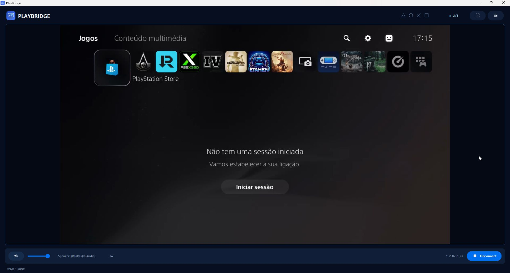
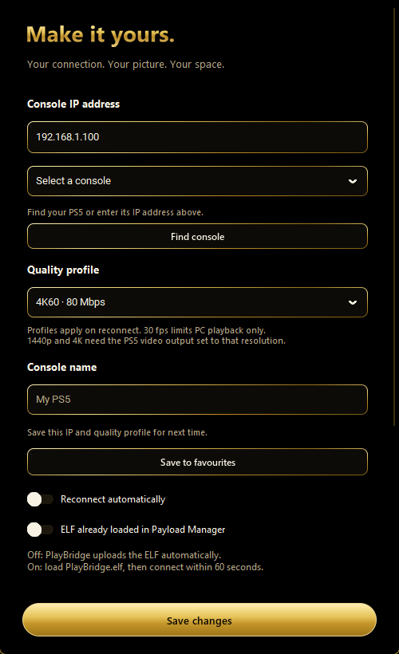
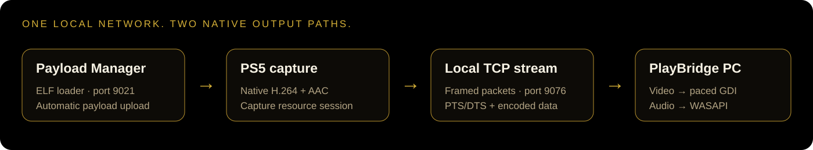

  
  
  

# PlayBridge

Created by **[ramalhoboss](https://github.com/ramalhoboss)** · **[Follow @nuno_leugim_10 on X](https://x.com/nuno_leugim_10)**

**PS5 video and audio on your Windows PC. Open Payload Manager on your PS5, launch PlayBridge on your PC, and connect.**

PlayBridge automatically sends its embedded payload to the console's ELF loader, then opens the live audio/video stream. In automatic mode, you do not need to select or load the ELF manually on every launch.

No HDMI capture card. No official Remote Play client or PSN Remote Play pairing. A jailbreak-capable PS5 with a working Payload Manager ELF loader is required.

> Screenshots show the real application. PlayBridge is in English; the console's own menu language remains whatever you selected on the PS5.

## Development preview — v1.2.0

The capture-options development branch adds native-size PNG screenshots (F8), MP4 recording with console audio (F9), capture-folder controls, automatic reconnect and negotiated 4/8/12 Mbit/s bitrate targets. Data saver limits PC presentation to about 30 fps; source capture and recordings retain their own cadence. See [capture options and validation](docs/CAPTURE-OPTIONS.md).

The current public download below remains v1.1.1 while the new build is reviewed.

## Download

**[Get the latest release](https://github.com/ramalhoboss/PlayBridge/releases/latest)**

| File | What it contains |
|---|---|
| [PlayBridge.exe](https://github.com/ramalhoboss/PlayBridge/releases/download/v1.1.1/PlayBridge.exe) | Portable Windows application, including Python dependencies and the embedded ELF. |
| [PlayBridge.elf](https://github.com/ramalhoboss/PlayBridge/releases/download/v1.1.1/PlayBridge.elf) | Standalone PS5 payload for manual loading. |
| [PlayBridge-Windows-v1.1.1.zip](https://github.com/ramalhoboss/PlayBridge/releases/download/v1.1.1/PlayBridge-Windows-v1.1.1.zip) | Windows EXE and quick-start instructions. |
| [PlayBridge-Payload-v1.1.1.zip](https://github.com/ramalhoboss/PlayBridge/releases/download/v1.1.1/PlayBridge-Payload-v1.1.1.zip) | ELF and manual-mode instructions. |
| [PlayBridge-Complete-v1.1.1.zip](https://github.com/ramalhoboss/PlayBridge/releases/download/v1.1.1/PlayBridge-Complete-v1.1.1.zip) | Both files, quick-start instructions and component notices. |
| [Third-party-licenses.zip](https://github.com/ramalhoboss/PlayBridge/releases/download/v1.1.1/Third-party-licenses.zip) | Component notices for standalone downloads. |
| [PlayBridge-Source-v1.1.1.zip](https://github.com/ramalhoboss/PlayBridge/releases/download/v1.1.1/PlayBridge-Source-v1.1.1.zip) | Application and payload source, assets, tests and build instructions. |
| [SHA256SUMS.txt](https://github.com/ramalhoboss/PlayBridge/releases/download/v1.1.1/SHA256SUMS.txt) | Checksums for the release downloads. |

Download the release assets above to run the application. To inspect or build it, browse [app/](app/), [payload/](payload/) and [tools/](tools/), or download the source archive below. GitHub's source archives contain source files, not the Windows EXE.

## Requirements

- A PS5 on **firmware 13.60**, with the required homebrew/jailbreak environment already working.
- Payload Manager with an **ELF loader listening on TCP port 9021** for automatic loading.
- A **64-bit Windows PC** and a stereo audio output. The tested environment is Windows 11; other Windows versions are not verified here.
- Console and PC on the same local network.
- The tested console output was **1080p**. Compatibility with every display mode, game, title and audio device has not been established.

The payload explicitly checks firmware value **0x13600007**. Other firmware versions are not supported by this build.

## Quick start — automatic mode

1. Start your PS5 and open **Payload Manager**. Make sure its ELF loader is available on port **9021**.
2. Open **PlayBridge.exe** on the PC. No separate Python installation is needed.
3. Open **Connection settings** using the sliders icon in the top-right corner.
4. Enter your console's local IP address, such as **192.168.1.100**.
5. Leave **ELF already loaded in Payload Manager** switched **off**, then select **Save changes**.
6. Select **Connect** if needed. PlayBridge uploads the embedded ELF and connects to the video/audio stream on port **9076**.

The application attempts to connect at startup using its saved settings. IP/mode changes apply to the next connection. Once configured, the usual workflow is simply **open Payload Manager → open PlayBridge**.

A visible live image confirms the capture payload is running. The exact way a received ELF appears in Payload Manager's process list has not been characterized; PlayBridge does not depend on selecting it from the local payload list.

### Manual mode

1. Open Connection settings and switch **ELF already loaded in Payload Manager** **on**.
2. Save your console IP and connection mode.
3. Load **PlayBridge.elf** through your preferred PS5 payload loader.
4. Connect from the PC within **60 seconds**.

The standalone ELF waits for one viewer per execution. After ending a manual session, load it again before connecting another viewer. Automatic mode handles the upload on each new connection.

## Features

| Area | Current implementation |
|---|---|
| Video | Native console capture, H.264, tested at **1920×1080**, nominal **59.94 fps**, target **8 Mbit/s**. |
| Audio | AAC at **128 kbit/s**, decoded to **48 kHz stereo** and played through **Windows WASAPI**. |
| Automatic loading | The EXE embeds PlayBridge.elf and sends it to the console's existing ELF loader. |
| Presentation | Direct Windows **GDI** drawing, avoiding PIL/ImageTk copies in the default path. |
| Frame handling | Latest-frame slots instead of an unbounded presentation backlog; old prepared frames may be replaced. |
| Audio buffering | Bounded PCM queue; if it exceeds approximately **60 ms**, it is trimmed toward **40 ms**. |
| Window modes | Resizable window, fullscreen, centered image and preserved aspect ratio. Black bars can appear when the available area is not 16:9. |
| Sound controls | Output-device selector, volume slider and mute/unmute button. |
| Session controls | Connect/disconnect and automatic/manual loading modes. |
| Diagnostics | Optional presented fps, PC processing interval and audio-queue length. |
| Interface | English console-inspired blue/navy theme, custom icons and hover descriptions. |
| Distribution | A portable single-file Windows EXE; no separate Python installation. |
| Preferences | Saved console IP, connection mode, output device and diagnostic preference. |
| Runtime | No artificial ten-minute stream limit. Long sessions still need wider stability testing. |
| v1.1.1 fix | Deterministic conversion rounding removes the blinking first-column dashes seen at some window sizes. The picture is not cropped to hide them. |

### Controls

| Control | Action |
|---|---|
| Fullscreen icon / **F11** | Enter or leave fullscreen. |
| Double-click video | Toggle fullscreen. |
| **Escape** | Leave fullscreen. |
| Speaker icon | Mute/unmute. |
| Volume slider | Adjust playback volume. |
| Audio dropdown | Select a WASAPI output. |
| Sliders icon | Open connection settings and performance stats. |
| **Connect / Disconnect** | Start or end the streaming session. |

## How it works

1. **Load:** the PC sends PlayBridge.elf to the existing loader. It does not install firmware or create a jailbreak.
2. **Reserve and capture:** the payload uses firmware-specific native capture/resource interfaces, including **SceAvcap2** and **ResourceArbitrator**, to open the capture session and its resources.
3. **Encode on the console:** the PS5's capture pipeline supplies H.264 video and AAC audio. The payload sends encoded data rather than uncompressed framebuffer pixels.
4. **Transport:** a small custom TCP framing protocol carries packet type, size and PTS/DTS. TCP_NODELAY and a bounded send buffer help avoid unnecessary batching.
5. **Decode and present:** the PC uses PyAV for H.264/AAC, a recent-frame conversion slot, direct GDI for video, and sounddevice/PortAudio with WASAPI for audio.
6. **Release:** closing/disconnecting the receiver ends the session; the payload stops and closes capture resources through the normal client interfaces.

### How we developed it

Development started with analysis of modules obtained from the owner's console memory dumps. Static analysis and decompilation helped identify capture configuration, resource reservation and packet metadata. Small payload probes were then tested on firmware 13.60 before the audio/video sender and PC receiver were built.

The receiver moved from an external playback path to direct decoding, bounded queues and WASAPI audio. Profiling then identified conversion and image upload as the largest PC-side costs, leading to direct GDI presentation. Finally, a synthetic-image regression reproduced the flashing left-edge pixels in the conversion stage; deterministic rounding removed them without cropping the frame.

This release does **not** distribute the console's firmware dumps or extracted proprietary system modules. Native console modules remain on the user's PS5. The PC receiver, UI, conversion code, native C payload and build scripts are published in this repository. See [Building from source](docs/BUILDING.md). The matching homebrew SDK and third-party libraries are external dependencies; console firmware dumps are not required to build these sources.

## Source code

- **[app/](app/)** — Python receiver, English interface, native GDI presenter and deterministic video conversion.
- **[payload/](payload/)** — firmware-13.60 C capture sender and packet framing.
- **[app/assets/](app/assets/)** — application icon and control artwork.
- **[tools/](tools/)** — payload compiler wrapper and artwork generator.
- **[tests/](tests/)** — synthetic conversion regression test.
- **[PlayBridge.spec](PlayBridge.spec)** — portable PyInstaller packaging recipe.
- **[Build guide](docs/BUILDING.md)** — dependencies, running from source, compiling the ELF and packaging the EXE.

The application source retains the repository's **GPL-3.0** license; third-party components keep their own terms. Portability changes remove development-machine paths and allow an optional PLAYBRIDGE_DEPS environment variable. The capture/stream protocol and the published v1.1.1 binaries are unchanged.

## Measurements — what the numbers mean

A **20.04-second** v1.1.1 live test on the development machine produced:

| Measurement | Result |
|---|---:|
| Video frames decoded and presented | **1,134** |
| Final presentation-rate indicator | **59 fps** |
| Complete packet received → presentation update, mean | **4.968 ms** |
| Same PC interval, 95th percentile | **6.337 ms** |
| Audio decoded | **922,624 stereo samples** |
| PCM bytes delivered to the audio callback | **3,690,496** |
| Connection errors in that test | **0** |

These are **PC pipeline measurements**, not total HDMI-to-PC latency, controller-to-photon latency or monitor response time. A short test does not prove long-term stability, perfect A/V synchronization or universal device compatibility. Audio audibility was confirmed by the owner during development; the final metrics test verifies data flow, not a fresh human listening assessment.

An earlier consecutive comparison observed approximately **14.2 ms → 4.8 ms** in the measured PC interval when moving from ImageTk to direct GDI. That comparison used sequential live sessions, not an identical recorded workload.

The border fix was checked using **144 corrected synthetic frames**, six output sizes and both RGB24/BGR0 conversion paths, plus before/after visual inspection and real-stream comparison.

## Current scope and limitations

- **13.60 only.** Firmware-specific interfaces and offsets are used.
- **1080p tested.** Window scaling does not create native 1440p/4K capture detail. The test display supports up to 1080p.
- **Streaming only.** Controller input forwarding is not implemented; use your controller with the console.
- **One viewer per payload execution.** Only one PlayBridge/legacy receiver session should run on the PC at once.
- **Trusted local network.** No encrypted Internet relay, remote account service or authenticated stream transport is provided.
- Reconnect is manual after interruptions. Automatic recovery from rest mode/HDMI reconfiguration is not yet implemented.
- This is a development release, without a signed installer or a verified support matrix for every game/output mode.

## Troubleshooting

| Symptom | Check |
|---|---|
| Cannot connect | Console IP, same LAN, Payload Manager's ELF loader on 9021, and no other active viewer. |
| Manual mode times out | Reload the ELF, then connect within 60 seconds. |
| Picture but no sound | Choose the correct WASAPI output, unmute and check the volume. Some console content may be silent. |
| Black bars in a window | Expected when the video and available window area have different aspect ratios. Try fullscreen. |
| Bright blinking dashes on the left edge | Update the PC EXE to **v1.1.1 or newer**. This fix does not require a different ELF. |
| App says another receiver is running | Close the other PlayBridge or earlier Python receiver, then retry. |
| Stream stopped after sleep or HDMI changes | End the session and reconnect. In manual mode, reload the ELF. |

Preferences and local diagnostic files are stored in <code>%LOCALAPPDATA%\PlayBridge\</code>. When reporting an issue, include your version, firmware, display mode and a description; review logs for personal details before sharing them.

## Release history

- **v1.1.1:** fixed the blinking left-edge conversion artifacts; retained the English console theme and GDI presentation.
- **v1.1.0:** console-inspired interface, custom control icons and English application text.
- Earlier development builds established combined H.264/AAC streaming and WASAPI playback.

## Credits

Created by **[ramalhoboss](https://github.com/ramalhoboss)** · **[X: @nuno_leugim_10](https://x.com/nuno_leugim_10)**, with iterative testing on the owner's PS5 and PC. Built using Python, PyAV/FFmpeg, NumPy, CustomTkinter, Pillow, sounddevice/PortAudio, CFFI, PyInstaller and a PS5 homebrew payload SDK. Firmware research used static analysis/decompilation tools, including Ghidra.

PlayBridge is an independent homebrew project and is not affiliated with Sony Interactive Entertainment. Third-party components retain their respective licenses. No blanket license for third-party software or console firmware is granted by this repository.
