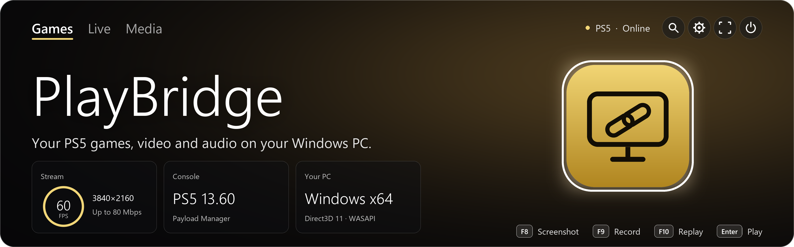
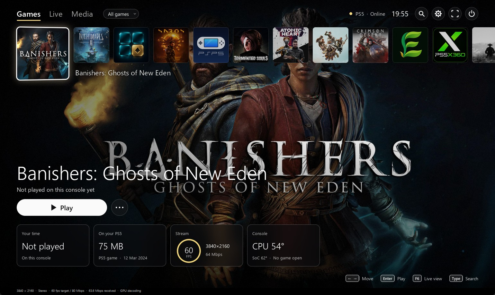
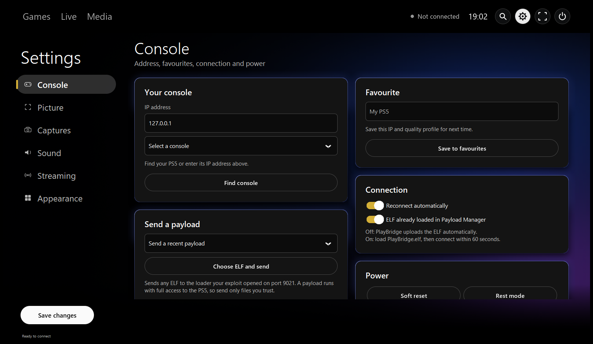
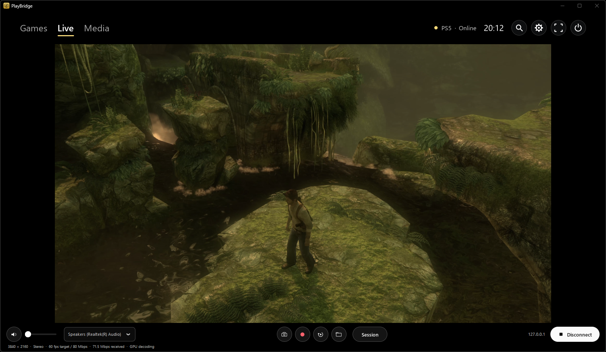
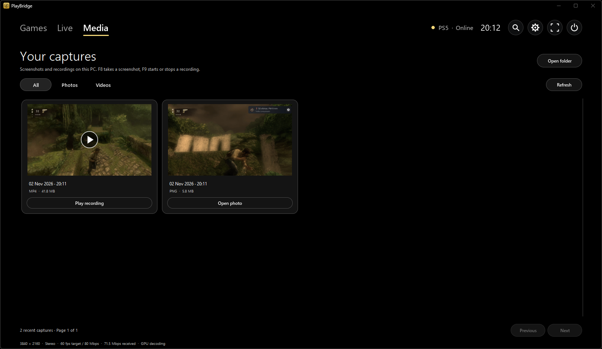
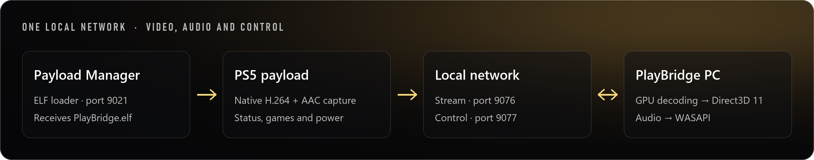

  
  
  
  
  

# PlayBridge

Created by **[ramalhoboss](https://github.com/ramalhoboss)** · **[Follow @nuno_leugim_10 on X](https://x.com/nuno_leugim_10)**

**Your PS5 games, video and audio on your Windows PC, at up to 4K. Open Payload Manager on your PS5, launch PlayBridge on your PC, and connect.**

PlayBridge automatically sends its embedded payload to the console's ELF loader, then opens the live audio/video stream. In automatic mode, you do not need to select or load the ELF manually on every launch.

No HDMI capture card. No official Remote Play client or PSN Remote Play pairing. A jailbreak-capable PS5 with a working Payload Manager ELF loader is required.

> Screenshots show the real application. The Games page above shows a real PS5 library: covers and music come from your own console when you connect, and none are included in the download. The game pictures further down are PS5 captures saved with PlayBridge. PlayBridge is in English; the console's own language remains whatever you selected on the PS5.

## New in v1.4.2

- **FSR 1 upscaling:** a new switch in **Settings → Picture**, off by default. When your screen is larger than the stream, such as a 1080p stream on a 1440p or 4K monitor, AMD FidelityFX Super Resolution 1 enlarges the picture along its edges, and **Sharpen picture** uses FSR's own sharpening. It works with the GPU video output on any graphics card.
- Includes the v1.4.1 fix: the IP address you type in Settings is the one PlayBridge uses. The payload is the same as in v1.4.0.

## New in v1.4.1

- **Your IP address is kept:** an address you type in **Settings → Console** is now always the one PlayBridge uses. Before, when nothing answered at that address and one PS5 answered elsewhere on the network, PlayBridge switched to that console without saying so.
- **Clearer connection errors:** the message names the address PlayBridge tried, and the address of a PS5 that answered instead, if there is one.
- PlayBridge still finds your console by itself while you have never typed an address, and still follows it when your router gives it a new one. The payload is the same as in v1.4.0.

## New in v1.4.0

- **Your games on the PC:** a Games page reads the library from your PS5, with each game's cover, its own music, your play time and its size. Select **Play** to launch a game, then resume or close it from the PC.
- **Gaming Mode:** your games fullscreen on the PC, with the console's menu kept off the PC screen. The TV still shows the PS5 as usual.
- **GPU video:** the graphics card decodes and draws the video. On the owner's PS5 over Wi-Fi this used about 0.22 processor cores instead of 1.3–1.4, with steadier frame timing. If it cannot start, PlayBridge falls back to the previous output by itself.
- **Instant replay:** keep the last 30 seconds, 60 seconds or 2 minutes in PC memory, and save it with **F10**.
- **New look:** one window with Games, Live and Media at the top, and Settings as a page of its own.
- **Console status and power:** the game in front, CPU and SoC temperature, rest mode, and soft reset (close and launch the game again). Reboot and Turn off are included but have not yet been tested on a console.
- **Steadier picture:** a sharper scaling filter, a frame clock that no longer runs fast after a missed monitor refresh, and an encoder that reopens after certain read errors.
- **Safer connect:** before sending the ELF, PlayBridge asks the console for its state, and stops with a message if it is resting or runs a firmware other than 13.60.

Automatic mode includes the updated payload. Manual users should load the v1.4.0 ELF.

## Download

**[Get the latest release](https://github.com/ramalhoboss/PlayBridge/releases/latest)**

| File | What it contains |
|---|---|
| [PlayBridge.exe](https://github.com/ramalhoboss/PlayBridge/releases/download/v1.4.2/PlayBridge.exe) | Portable Windows application, including Python dependencies and the embedded ELF. |
| [PlayBridge.elf](https://github.com/ramalhoboss/PlayBridge/releases/download/v1.4.2/PlayBridge.elf) | Standalone PS5 payload for manual loading. |
| [PlayBridge-Windows-v1.4.2.zip](https://github.com/ramalhoboss/PlayBridge/releases/download/v1.4.2/PlayBridge-Windows-v1.4.2.zip) | Windows EXE and quick-start instructions. |
| [PlayBridge-Payload-v1.4.2.zip](https://github.com/ramalhoboss/PlayBridge/releases/download/v1.4.2/PlayBridge-Payload-v1.4.2.zip) | ELF and manual-mode instructions. |
| [PlayBridge-Complete-v1.4.2.zip](https://github.com/ramalhoboss/PlayBridge/releases/download/v1.4.2/PlayBridge-Complete-v1.4.2.zip) | Both files, quick-start instructions and component notices. |
| [Third-party-licenses.zip](https://github.com/ramalhoboss/PlayBridge/releases/download/v1.4.2/Third-party-licenses.zip) | Component notices for standalone downloads. |
| [PlayBridge-Source-v1.4.2.zip](https://github.com/ramalhoboss/PlayBridge/releases/download/v1.4.2/PlayBridge-Source-v1.4.2.zip) | Application and payload source, assets, tests and build instructions. |
| [SHA256SUMS.txt](https://github.com/ramalhoboss/PlayBridge/releases/download/v1.4.2/SHA256SUMS.txt) | Checksums for the release downloads. |

Download the release assets above to run the application. To inspect or build it, browse [app/](app/), [payload/](payload/) and [tools/](tools/), or download the source archive. GitHub's source archives contain source files, not the Windows EXE.

## Requirements

- A PS5 on **firmware 13.60**, with the required homebrew/jailbreak environment already working.
- Payload Manager with an **ELF loader listening on TCP port 9021** for automatic loading.
- A **64-bit Windows PC** and a stereo audio output. The tested environment is Windows 11; other Windows versions are not verified here.
- For the GPU video output: a graphics card with Direct3D 11 and its video decoding. If the GPU cannot decode the stream, PlayBridge decodes on the processor; if Direct3D 11 cannot start, it draws with GDI.
- Console and PC on the same local network. Use Ethernet if you can, especially at the 4K bitrates.
- For 1440p or 4K: a display on the PS5 that accepts that resolution, and an HDMI cable rated for it.

The payload explicitly checks firmware value **0x13600007**. Other firmware versions are not supported by this build.

## How to use

### 1. Connect for the first time

1. Start your PS5 and open **Payload Manager**. Make sure its ELF loader is available on port **9021**.
2. Open **PlayBridge.exe** on the PC. No separate Python installation is needed.
3. Select the **gear** at the top right, or press **Ctrl+,**, to open **Settings**.
4. Under **Console**, select **Find console**, or type your console's local IP address, such as **192.168.1.100**. With one PS5 on your network you can also leave the address as it is: PlayBridge finds the console by itself. An address you type is always used as typed.
5. Under **Picture**, choose a **Quality profile**. **Balanced** is a good place to start.
6. Leave **ELF already loaded in Payload Manager** switched **off**, then select **Save changes**.

PlayBridge uploads its embedded ELF and connects on port **9076**. The mark next to **PS5** at the top turns gold and says **Online** while the session runs.

From then on, the usual workflow is simply **open Payload Manager → open PlayBridge**. It connects at startup using your saved settings.

### 2. Your games

PlayBridge opens on **Games**. Once connected, it reads the games installed on your PS5, with their covers, music, play time and size. Covers and music are kept on your PC so the page opens quickly next time; none are included in the download.

| On the Games page | Action |
|---|---|
| **←** **→**, mouse | Move between games. **Page Up** and **Page Down** move five at a time. |
| **↑** **↓** / the **All games** menu | Change the row: All games, Most played, A to Z, PS5 games or PS4 games. |
| **Enter** / **Play** | Launch the selected game. The page changes to **Live** when its picture arrives. |
| **Resume** | Shown instead of Play for the game that is already running. Goes back to its picture. |
| **⋯** next to Play | Close the running game, refresh the library or open the Live view. |
| Typing, or the search icon | Search your games. |
| **F6** | Switch between the game's picture and your games. |

Only one game runs at a time on a PS5, so launching a different game closes the one that is open. The background music and navigation sounds play only while your games are on screen, never over a game. You can turn them off, or change their volume, in **Settings → Sound**.

**Gaming Mode** (**Ctrl+G**, or **Settings → Appearance**) fills the PC screen with your games and keeps the console's own menu off it: when you leave a game, the PC shows your games again instead of the PS5 home screen. The TV connected to the PS5 still shows the console as usual.

### 3. Choose a quality

Profiles apply on the next connection. Bitrates are encoder targets: calm scenes use less.

| Profile | Picture | Bitrate target | PS5 video output needed |
|---|---|---:|---|
| Data saver | 1080p, painted at about 30 fps on the PC | 4 Mbit/s | 1080p |
| Balanced | 1080p60 | 8 Mbit/s | 1080p |
| High quality | 1080p60 | 12 Mbit/s | 1080p |
| Very high | 1080p60 | 16 Mbit/s | 1080p |
| Ultra | 1080p60 | 20 Mbit/s | 1080p |
| Maximum | 1080p60 | 30 Mbit/s | 1080p |
| 1440p60 | 2560×1440 | 20, 30 or 50 Mbit/s | 1440p or 4K |
| 4K60 | 3840×2160 | 40, 60 or 80 Mbit/s | 4K |

### 4. Get real 1440p or 4K

The capture follows the console's video output, so the PS5 has to be running at that resolution.

1. Connect the PS5 to a display that accepts 1440p or 4K, using an HDMI cable rated for it. On the test setup, a cable that worked at 1080p gave no picture at 2160p, and a different cable fixed it.
2. On the PS5, open **Settings → Screen and Video → Video Output** and set **Resolution** to that mode or to Automatic.
3. In PlayBridge, choose a 1440p or 4K profile and select **Save changes**.
4. Check the line at the bottom of the window. It shows the resolution you are really receiving, for example **3840 × 2160**, and says so if the stream stepped down.

A 1080p PC monitor shows a 4K stream scaled down to its own pixels. Screenshots and recordings keep the full size. The 60 fps is the rate of the capture: a game drawing 30 pictures per second still looks like 30 fps. In the games tested so far, each picture was captured twice.

### 5. While you play

| Control | Action |
|---|---|
| **Live** / **F6** | Show the game's picture. **F6** again goes back to your games. |
| Fullscreen icon / **F11** / double-click the video | Enter or leave fullscreen. The pointer hides after 2.5 seconds without movement. |
| **Escape** | Leave fullscreen. |
| Camera icon / **F8** | Save a PNG at the stream's full size. Window bars and controls are not included. |
| Record icon / **F9** | Start or stop an MP4 with console audio, without re-encoding. |
| Replay icon / **F10** | Save the instant replay as an MP4. |
| Folder icon / **Media** / **Ctrl+L** | Open your captures. |
| **Session** / **Ctrl+I** | Show or hide the session panel: frame rate, source size, PC timing, the game in front, a 60-second bitrate graph and the recording state. |
| Gear / **Ctrl+,** | Open Settings. |
| Power icon | Console power, and leaving Gaming Mode. |
| Speaker icon, slider and audio menu | Mute, set the volume and choose the Windows audio output. |
| **Connect / Disconnect** | Start or end the streaming session. |

Captures are saved in **Videos/PlayBridge**, in the Screenshots and Recordings folders. To change the place, use **Settings → Captures → Choose capture folder**. A recording waits for the next keyframe before it starts, and console audio is recorded even if you mute it on the PC.

**Instant replay** is set in **Settings → Captures**: Off, the last 30 seconds, 60 seconds or 2 minutes. It keeps the stream as it arrives, without re-encoding, in this PC's memory up to 1 GB, and nothing changes on the PS5.

The line at the bottom of the window shows the stream's size, bitrate target, received bitrate and whether the GPU is decoding. **Settings → Picture → Show performance stats** adds the frame rate, PC timing and audio queue to it.

### 6. Console power

The power icon, and **Settings → Console → Power**, need a connected PS5. Each command asks before it runs.

| Command | What it does | Tested on a PS5 |
|---|---|---|
| Soft reset | Closes the running game and launches it again. The PS5 itself has no soft reset. | Closing and launching each, yes; the two together, not yet |
| Rest mode | Puts the console into rest mode. | Yes |
| Reboot | Restarts the console. You need to load your exploit again afterwards. | Not yet |
| Turn off | Turns the console off. You need to load your exploit again next time. | Not yet |
| Recovery | Explains how to start Safe Mode from the console itself. PlayBridge never starts Safe Mode. | Instructions only |

### Save your consoles

In **Settings → Console**, type a name under **Favourite** and select **Save to favourites**. Each favourite keeps its IP address and quality profile. Choosing one from the console menu fills in the settings; select **Save changes** to use it.

### Manual mode

1. In **Settings → Console**, switch **ELF already loaded in Payload Manager** **on**, then save.
2. Load **PlayBridge.elf** through your preferred PS5 payload loader.
3. Connect from the PC within **60 seconds**.

The standalone ELF waits for one viewer per execution. After ending a manual session, load it again before connecting another viewer. Automatic mode handles the upload on each new connection.

## Features

| Area | Current implementation |
|---|---|
| Video | Native console capture, H.264, at 1080p, 1440p (experimental) and 4K (experimental), with a 60 fps capture rate and bitrate targets from 4 to 80 Mbit/s. |
| Audio | AAC at **128 kbit/s**, decoded to **48 kHz stereo** and played through **Windows WASAPI**. |
| Automatic loading | The EXE embeds PlayBridge.elf and sends it to the console's existing ELF loader. |
| Games | The PS5's installed games with covers, the game's own music where it has one, play time, last played and size. Play, Resume and Close, search and five rows. Read during a session and kept on the PC. |
| Gaming Mode | Your games fullscreen on the PC; when the console's menu comes to the front, the PC shows your games instead. |
| Console status | The game in front, CPU and SoC temperature, and whether a console found on the network is resting. |
| Power | Rest mode, soft reset (close and relaunch the game), and reboot and turn off (not yet tested on a console). Each asks first. |
| Presentation | **Direct3D 11** by default: the GPU decodes the video, converts its colour, scales it and presents it, with optional sharpening and optional AMD FSR 1 upscaling when the screen is larger than the stream. Windows **GDI** remains as the automatic fallback and as a switch in Settings. Both show one frame per monitor refresh from a short queue, and skip frames rather than letting the delay grow. |
| Decoding | Separate from the network thread, so a slow decoder drops video until the next keyframe instead of stalling audio or the connection. Software decoding uses frame threads above 1080p. |
| Audio buffering | Bounded PCM queue; if it exceeds approximately **60 ms**, it is trimmed toward **40 ms**. Above 1080p these limits are **160 ms** and **120 ms**. |
| Window modes | Resizable window, fullscreen, centered image and preserved aspect ratio. Black bars can appear when the available area is not 16:9. |
| Sound controls | Output-device selector, volume slider and mute/unmute button. The library's music and navigation sounds have their own switches and volume, and use a separate output that is closed while a game is on screen. |
| Session controls | Connect/disconnect, automatic/manual loading modes and optional automatic reconnect. |
| Console discovery | **Find console** listens for PS5 replies and scans the local network for Payload Manager. When the saved address does not answer and one PS5 does, PlayBridge follows that console, unless you typed the address yourself. Before sending the ELF, PlayBridge asks the console for its state, and stops with a message if it is resting or runs a firmware other than 13.60. Manual IP entry stays available. |
| Screenshots | Native-source-size PNG with F8; UI controls and window bars are excluded. |
| Recording | Packet-copy H.264/AAC MP4 with F9, bounded background writing and graceful stop/finalization. |
| Instant replay | The last 30 s, 60 s or 2 minutes of the stream kept in PC memory (up to 1 GB) and saved as an MP4 with F10, without re-encoding. |
| Media | Photos and MP4 recordings with thumbnails, filters and paging, read in the background. |
| Diagnostics | Session panel and status line, plus an exported ZIP without IP addresses, device names, file paths or logs. |
| Interface | English. Black, frosted cards with a hairline rim, white type and gold as a small accent. Animations are optional, and nothing is redrawn for video frames. |
| PC controller | A controller connected to the PC (XInput or a standard Windows game controller) can move around the games page. It is not sent to the console. |
| Distribution | A portable single-file Windows EXE; no separate Python installation. |
| Preferences | Saved console, favourites, quality profile, audio output, capture folder, replay length, video output, sounds and Gaming Mode. |
| Runtime | No artificial stream time limit. Long sessions still need wider stability testing. |

## How it works

1. **Load:** the PC sends PlayBridge.elf to the existing loader. It does not install firmware or create a jailbreak.
2. **Reserve and capture:** the payload uses firmware-specific native capture/resource interfaces, including **SceAvcap2** and **ResourceArbitrator**, to open the capture session and its resources. It reads the console's video output first and picks the highest capture that output allows.
3. **Encode on the console:** the PS5's capture pipeline supplies H.264 video and AAC audio. The payload sends encoded data rather than uncompressed framebuffer pixels.
4. **Transport:** a small custom TCP framing protocol carries packet type, size and PTS/DTS. TCP_NODELAY and a bounded send buffer help avoid unnecessary batching.
5. **Decode and present:** the PC uses PyAV for H.264/AAC, with Direct3D 11 video decoding on the GPU when it is available. A short frame queue is paced to the monitor's refresh, and Direct3D 11 converts, scales and presents each frame, with GDI as the fallback. Audio uses sounddevice/PortAudio with WASAPI.
6. **Control:** during a session the payload also opens a control port, 9077, on which the PC asks for the console's status and game library, and sends launch, close and power commands. It answers only while the session runs.
7. **Release:** closing/disconnecting the receiver ends the session; the payload stops and closes capture resources through the normal client interfaces.

### How we developed it

Development started with analysis of modules obtained from the owner's console memory dumps. Static analysis and decompilation helped identify capture configuration, resource reservation and packet metadata. Small payload probes were then tested on firmware 13.60 before the audio/video sender and PC receiver were built.

The receiver moved from an external playback path to direct decoding, bounded queues and WASAPI audio. Profiling then identified conversion and image upload as the largest PC-side costs, leading to direct GDI presentation. A synthetic-image regression reproduced the flashing left-edge pixels in the conversion stage; deterministic rounding removed them without cropping the frame.

For v1.3.0, live runs on a 4K console output showed where fluidity was being lost: an encoder byte budget that skipped frames after keyframes, decoding on the network thread, and frames painted at uneven times. Each was changed and measured again on the console.

For v1.4.0, the console's own system interfaces were used to read the game library and status, launch and close games, and put the console to rest, each tried on the owner's PS5 before it went into the app. The GPU output was measured against GDI on the same console, and a run that skipped frames in clusters led to the refresh clock fix.

This project does **not** distribute the console's firmware dumps, extracted proprietary system modules or extracted console artwork. Game covers and music shown on the Games page are read from your own console while you use the app, and stay on your PC. Native console modules remain on the user's PS5. The PC receiver, UI, conversion code, native C payload and build scripts are published in this repository. See [Building from source](docs/BUILDING.md). The matching homebrew SDK and third-party libraries are external dependencies; console firmware dumps are not required to build these sources.

## Source code

- **[app/](app/)** — Python receiver, English interface, Games page and Gaming Mode, Direct3D 11 and GDI presenters, frame pacing, console control, the library's sounds, Media page and diagnostics.
- **[payload/](payload/)** — firmware-13.60 C capture sender, console control port, capture options and packet framing.
- **[app/assets/](app/assets/)** — application icon and control artwork.
- **[tools/](tools/)** — payload compiler wrapper, the app's artwork generator and the README art, drawn with the app's own code.
- **[tests/](tests/)** — automated tests for conversion, capture, pacing, both presenters, console control, the games page, sounds, metrics, discovery, the desktop features and the theme.
- **[PlayBridge.spec](PlayBridge.spec)** — portable PyInstaller packaging recipe.

Guides:

- **[Building from source](docs/BUILDING.md)** — dependencies, running from source, tests, compiling the ELF and packaging the EXE.
- **[Capture options](docs/CAPTURE-OPTIONS.md)** — profiles, encoder budget, presentation and all live measurements.
- **[Gaming desktop](docs/GAMING-DESKTOP.md)** — pages, Games, Gaming Mode, session panel and shortcuts.
- **[Stream health](docs/STREAM-HEALTH.md)** — what the figures mean, diagnostics export and console discovery.
- **[Visual theme](docs/VISUAL-THEME.md)** — how the interface is drawn.

The application source retains the repository's **GPL-3.0** license; third-party components keep their own terms.

## Measurements

These come from the owner's PS5 13.60 and PC (Radeon RX 6600, 1080p monitor at 59 Hz), in short live runs. The full tables for the earlier versions are in [capture options](docs/CAPTURE-OPTIONS.md).

**v1.4.0, GPU output against the previous GDI output**, Wi-Fi, a game being played at 4K, three pairs of runs of 20–40 seconds:

| | Direct3D 11 | GDI |
|---|---:|---:|
| Processor use of the whole app | 0.22–0.23 cores | 1.29–1.43 cores |
| Screen updates per second | 59.8–59.9 | 59.7–59.9 |
| Frame interval, 95th percentile | 17.2–17.4 ms | 18.3–18.4 ms |
| PC time from receiving a frame to presenting it, median | 36–50 ms | 36–59 ms |
| The same on the quiet console menu | 15 ms | 32–33 ms |

- Over Wi-Fi the PC time depends mostly on how unevenly frames arrive, because the frame queue waits for late frames.
- One early Direct3D 11 run on the console menu showed 47.9 screen updates per second. It did not repeat in later runs, and the queue for frames decoded on the GPU was enlarged afterwards.
- Some runs, with either output, skipped 20–28 frames in clusters about a second long. This was traced to the refresh clock running fast after a missed monitor refresh. With the fix, local runs of 30 seconds skipped 0, 0 and 1 frames instead of 1, 2 and 28. The fix has not yet been measured on the console.
- On the Games page, a library of 54 games read all its covers and music, and a game's picture appeared about 1.1 seconds after selecting **Play**.

**v1.3.0, packaged app, GDI output**, runs of about 30 seconds on a 60 Hz monitor:

| | 1080p | 4K (80 Mbit/s profile) |
|---|---:|---:|
| Screen updates per second | 59.7–59.8 | 58.2–59.2 |
| Refreshes with no update | 0.2–0.4% | 1.3–2.9% |
| Longest hold | 50 ms | 50–100 ms |
| PC time from receiving a frame to painting it | 40–43 ms | 49–62 ms |

- One further 4K run was much worse, with a 400 ms hold and 240 of 1799 frames not painted. It was the first launch after building the app. The cause was not found, and it may happen again.
- A session of about 3.5 minutes on the 4K 80 Mbit/s profile painted 12,219 of 12,582 decoded frames with no connection error, at about 37 Mbit/s for that content.
- A 20-second 4K recording reopened as 3840×2160 at 59.94 fps, with 1191 frames, no missing frames and AAC audio of the same length.

These are **PC pipeline measurements**, not total HDMI-to-PC latency, controller-to-photon latency or monitor response time. A short test does not prove long-term stability, perfect A/V synchronization or universal device compatibility. The GPU output has been measured on one graphics card only.

## Current scope and limitations

- **13.60 only.** Firmware-specific interfaces and offsets are used.
- **1080p tested; 1440p and 4K experimental.** With a 4K output, the 1440p and 4K profiles streamed at their native size at a 60 fps capture rate, on the console's menus and in a game, where the game itself was drawing about 30 fps. Long sessions have not been tested, and a coded 4K stream does not prove that a game renders at 4K. On a lower output they stream at the highest resolution it allows and say so. See [capture options](docs/CAPTURE-OPTIONS.md).
- **No controller input to the console.** Use your controller with the PS5. A controller on the PC only moves around the games page, and few controller models have been tried.
- **Reboot and Turn off are untested.** They are in the app, each behind a question, but have not yet been run on a console. Rest mode is confirmed. After a reboot or power off you need to load your exploit again.
- **No Home button.** Calls that should show the console's home screen returned success and changed nothing, so the command was removed. In Gaming Mode the PC shows your games instead.
- **One game at a time.** This is how the PS5 works: launching another game closes the one that is open.
- **GPU output tested on one PC.** It needs Direct3D 11 video decoding; other GPUs and monitors above 60 Hz have not been tried. If it fails, PlayBridge falls back to GDI, and **Settings → Picture → GPU video output** turns it off.
- **One viewer per payload execution.** Only one PlayBridge/legacy receiver session should run on the PC at once.
- **Trusted local network.** No encrypted Internet relay, remote account service or authenticated stream transport is provided.
- Automatic reconnect retries connection loss with 2/4/8-second backoff. It does not wake the PS5; recovery still requires the console and ELF loader to be available. Every rest-mode/HDMI scenario has not been validated.
- This is a development release, without a signed installer or a verified support matrix for every game/output mode.

## Troubleshooting

| Symptom | Check |
|---|---|
| Windows warns before opening the EXE | The EXE is not signed. Compare it with SHA256SUMS.txt, then choose **More info → Run anyway** if you trust it. |
| Cannot connect | Console IP, same LAN, Payload Manager's ELF loader on 9021, and no other active viewer. The message names the address PlayBridge tried. |
| PlayBridge says no PS5 answered at your address, but one did at another | The address you typed does not belong to your console. Enter the address in the message, or select **Find console**. |
| **Find console** finds nothing | VPNs, network isolation and firewalls can block it. Type the IP address instead. Discovery does not wake the console or start Payload Manager. |
| PlayBridge says the PS5 is in rest mode, or runs another firmware | Wake the console and load your exploit. Other firmware than 13.60 is refused before anything is sent. |
| The Games page is empty | Games are read once connected. Use **⋯ → Refresh library**. Covers and music arrive one by one the first time. |
| A game shows "controller not detected" | That is the game itself on the PS5. Turn on the controller that is paired with the console. |
| Picture looks wrong, black or stutters on the GPU output | Switch off **Settings → Picture → GPU video output** and restart PlayBridge to use GDI. Please report your graphics card. |
| A 4K profile gives 1080p | The PS5's video output is lower than the profile. Check the line at the bottom of the window, the PS5's Resolution setting, the display and the HDMI cable. |
| No picture on the TV at 2160p | Try an HDMI cable rated for 4K at 60 Hz. |
| 4K does not look sharp on my PC | A 1080p monitor shows the stream scaled down. Try **Sharpen picture**, or open a screenshot or recording to see the full size. |
| 1080p looks soft on a 1440p or 4K monitor | Turn on **Settings → Picture → FSR 1 upscaling**, and **Sharpen picture** for its sharpening. It needs the GPU video output. |
| Stutter at high profiles | Try a lower bitrate, use Ethernet and close heavy programs. Check the session panel: a game at 30 fps will not look like 60. |
| F10 says instant replay is off | Choose a length in **Settings → Captures → Instant replay**. |
| Manual mode times out | Reload the ELF, then connect within 60 seconds. |
| Picture but no sound | Choose the correct WASAPI output, unmute and check the volume. Some console content may be silent. |
| Music plays on the Games page | Turn off **Background music** in **Settings → Sound**, or lower the library volume. It never plays over a game. |
| Black bars in a window | Expected when the video and available window area have different aspect ratios. Try fullscreen. |
| App says another receiver is running | Close the other PlayBridge or earlier receiver, then retry. |
| Stream stopped after sleep or HDMI changes | Automatic reconnect retries if enabled. The console and loader must be running. In manual mode, reload the ELF. |
| Recording is waiting | It waits for a video keyframe and audio before starting a valid MP4. |
| Recording stopped during disconnect | The clip is finalized before recovery; start another recording after reconnection. |

Preferences, the game library and local diagnostic files are stored in <code>%LOCALAPPDATA%\PlayBridge\</code>. When reporting an issue, include your version, firmware, display mode, graphics card and a description, or use **Export diagnostics** in the settings or the session panel. Review logs for personal details before sharing them.

## Release history

- **v1.4.2:** optional AMD FSR 1 upscaling on the GPU video output, for screens larger than the stream.
- **v1.4.1:** an IP address typed in Settings is always used, and connection errors name the address tried and any PS5 that answered elsewhere.
- **v1.4.0:** Games page with Play, Resume and Close, Gaming Mode, Direct3D 11 output with GPU decoding, instant replay, a new one-window design, console status and power, a steadier refresh clock, sharper scaling, encoder recovery and firmware-aware discovery.
- **v1.3.0:** experimental 1440p and 4K, refresh-paced presentation, larger encoder frame budget, flicker fix, black and gold desktop, capture library with thumbnails, stats panel, console discovery, favourites and diagnostics export.
- **v1.2.0:** native PNG screenshots, MP4 recording with sound, capture library, quality targets and automatic reconnect.
- **v1.1.1:** fixed the blinking left-edge conversion artifacts; retained the English console theme and GDI presentation.
- **v1.1.0:** console-inspired interface, custom control icons and English application text.
- Earlier development builds established combined H.264/AAC streaming and WASAPI playback.

## Credits

Created by **[ramalhoboss](https://github.com/ramalhoboss)** · **[X: @nuno_leugim_10](https://x.com/nuno_leugim_10)**, with iterative testing on the owner's PS5 and PC. Built using Python, PyAV/FFmpeg, Direct3D 11, NumPy, CustomTkinter, Pillow, sounddevice/PortAudio, CFFI, PyInstaller and a PS5 homebrew payload SDK. Firmware research used static analysis/decompilation tools, including Ghidra.

PlayBridge is an independent homebrew project and is not affiliated with Sony Interactive Entertainment. Third-party components retain their respective licenses. No blanket license for third-party software or console firmware is granted by this repository.
