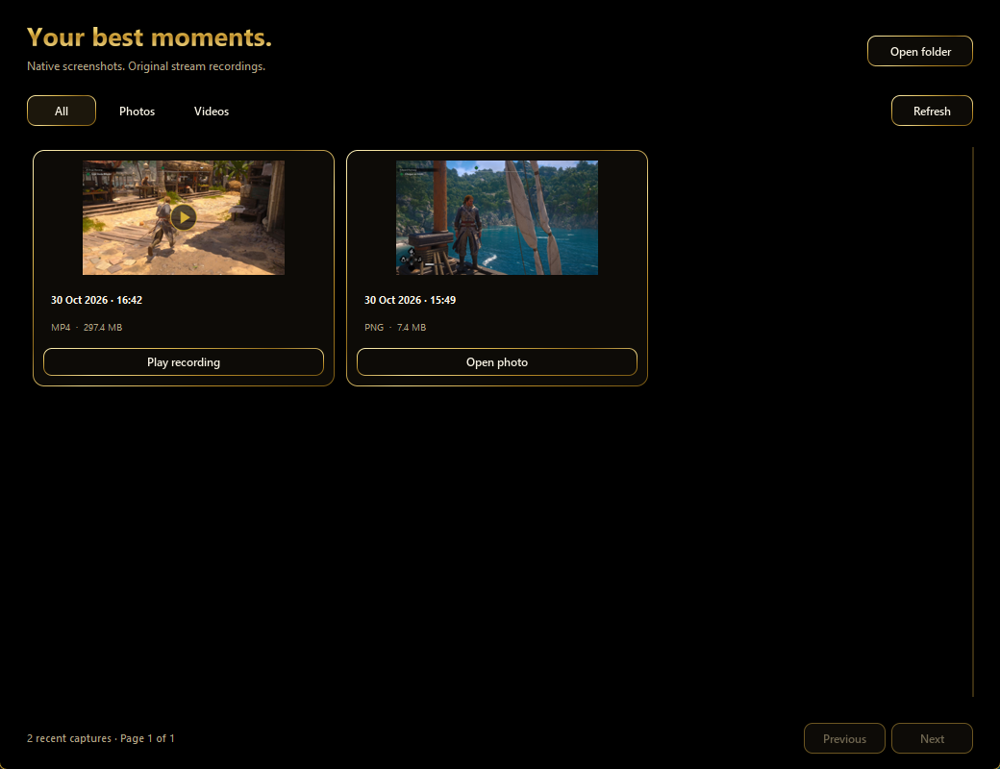

  
  
  
  

# PlayBridge

Created by **[ramalhoboss](https://github.com/ramalhoboss)** · **[Follow @nuno_leugim_10 on X](https://x.com/nuno_leugim_10)**

**PS5 video and audio on your Windows PC, at up to 4K. Open Payload Manager on your PS5, launch PlayBridge on your PC, and connect.**

PlayBridge automatically sends its embedded payload to the console's ELF loader, then opens the live audio/video stream. In automatic mode, you do not need to select or load the ELF manually on every launch.

No HDMI capture card. No official Remote Play client or PSN Remote Play pairing. A jailbreak-capable PS5 with a working Payload Manager ELF loader is required.

> Screenshots show the real application, and the picture on screen is a PS5 capture saved with PlayBridge. PlayBridge is in English; the console's own language remains whatever you selected on the PS5.

## New in v1.3.0

- **1440p and 4K (experimental):** twelve quality profiles from 4 to 80 Mbit/s. The capture follows the PS5's video output, and PlayBridge tells you when it has to step down.
- **Smoother picture:** video is painted one frame per monitor refresh. In live tests, the share of game pictures shown for the right length of time rose from 70–76% to 97% at 4K and from 83–96% to 99% at 1080p. This adds some video delay; see [Measurements](#measurements).
- **Fewer stalls from the console:** a larger encoder frame budget took a game scene from about 35 to 60 captured frames per second.
- **No more flicker** when the mouse moves over the video.
- **New black and gold desktop:** navigation for Live, Media, Stats and Setup, with thin gold rims and fully redrawn buttons.
- **Capture library:** photos and recordings with real thumbnails, filters and paging.
- **Stats panel:** source size, presented fps, PC timing and a 60-second bitrate graph.
- **Find console and favourites:** look for your PS5 on the network and save named consoles with their quality.
- **Diagnostics export:** a ZIP of measurements that leaves out IP addresses, device names and file paths.

Automatic mode includes the updated payload. Manual users should load the v1.3.0 ELF.

## Download

**[Get the latest release](https://github.com/ramalhoboss/PlayBridge/releases/latest)**

| File | What it contains |
|---|---|
| [PlayBridge.exe](https://github.com/ramalhoboss/PlayBridge/releases/download/v1.3.0/PlayBridge.exe) | Portable Windows application, including Python dependencies and the embedded ELF. |
| [PlayBridge.elf](https://github.com/ramalhoboss/PlayBridge/releases/download/v1.3.0/PlayBridge.elf) | Standalone PS5 payload for manual loading. |
| [PlayBridge-Windows-v1.3.0.zip](https://github.com/ramalhoboss/PlayBridge/releases/download/v1.3.0/PlayBridge-Windows-v1.3.0.zip) | Windows EXE and quick-start instructions. |
| [PlayBridge-Payload-v1.3.0.zip](https://github.com/ramalhoboss/PlayBridge/releases/download/v1.3.0/PlayBridge-Payload-v1.3.0.zip) | ELF and manual-mode instructions. |
| [PlayBridge-Complete-v1.3.0.zip](https://github.com/ramalhoboss/PlayBridge/releases/download/v1.3.0/PlayBridge-Complete-v1.3.0.zip) | Both files, quick-start instructions and component notices. |
| [Third-party-licenses.zip](https://github.com/ramalhoboss/PlayBridge/releases/download/v1.3.0/Third-party-licenses.zip) | Component notices for standalone downloads. |
| [PlayBridge-Source-v1.3.0.zip](https://github.com/ramalhoboss/PlayBridge/releases/download/v1.3.0/PlayBridge-Source-v1.3.0.zip) | Application and payload source, assets, tests and build instructions. |
| [SHA256SUMS.txt](https://github.com/ramalhoboss/PlayBridge/releases/download/v1.3.0/SHA256SUMS.txt) | Checksums for the release downloads. |

Download the release assets above to run the application. To inspect or build it, browse [app/](app/), [payload/](payload/) and [tools/](tools/), or download the source archive. GitHub's source archives contain source files, not the Windows EXE.

## Requirements

- A PS5 on **firmware 13.60**, with the required homebrew/jailbreak environment already working.
- Payload Manager with an **ELF loader listening on TCP port 9021** for automatic loading.
- A **64-bit Windows PC** and a stereo audio output. The tested environment is Windows 11; other Windows versions are not verified here.
- Console and PC on the same local network. Use Ethernet if you can, especially at the 4K bitrates.
- For 1440p or 4K: a display on the PS5 that accepts that resolution, and an HDMI cable rated for it.

The payload explicitly checks firmware value **0x13600007**. Other firmware versions are not supported by this build.

## How to use

### 1. Connect for the first time

1. Start your PS5 and open **Payload Manager**. Make sure its ELF loader is available on port **9021**.
2. Open **PlayBridge.exe** on the PC. No separate Python installation is needed.
3. Select **SETUP** on the left, or the sliders icon at the top right.
4. Select **Find console**, or type your console's local IP address, such as **192.168.1.100**.
5. Choose a **Quality profile**. **Balanced** is a good place to start.
6. Leave **ELF already loaded in Payload Manager** switched **off**, then select **Save changes**.

PlayBridge uploads its embedded ELF and connects on port **9076**. The status mark at the top turns gold and says **LIVE** when the stream is running.

From then on, the usual workflow is simply **open Payload Manager → open PlayBridge**. It connects at startup using your saved settings.

### 2. Choose a quality

Profiles apply on the next connection. Bitrates are encoder targets: calm scenes use less.

| Profile | Picture | Bitrate target | PS5 video output needed |
|---|---|---:|---|
| Data saver | 1080p, painted at about 30 fps on the PC | 4 Mbit/s | 1080p |
| Balanced | 1080p60 | 8 Mbit/s | 1080p |
| High quality | 1080p60 | 12 Mbit/s | 1080p |
| Very high | 1080p60 | 16 Mbit/s | 1080p |
| Ultra | 1080p60 | 20 Mbit/s | 1080p |
| Maximum | 1080p60 | 30 Mbit/s | 1080p |
| 1440p60 | 2560×1440 | 20, 30 or 50 Mbit/s | 1440p or 4K |
| 4K60 | 3840×2160 | 40, 60 or 80 Mbit/s | 4K |

### 3. Get real 1440p or 4K

The capture follows the console's video output, so the PS5 has to be running at that resolution.

1. Connect the PS5 to a display that accepts 1440p or 4K, using an HDMI cable rated for it. On the test setup, a cable that worked at 1080p gave no picture at 2160p, and a different cable fixed it.
2. On the PS5, open **Settings → Screen and Video → Video Output** and set **Resolution** to that mode or to Automatic.
3. In PlayBridge, choose a 1440p or 4K profile and select **Save changes**.
4. Check the line under the video. It shows the resolution you are really receiving, for example **3840 × 2160**, and says so if the stream stepped down.

A 1080p PC monitor shows a 4K stream scaled down to its own pixels. Screenshots and recordings keep the full size. The 60 fps is the rate of the capture: a game drawing 30 pictures per second still looks like 30 fps. In the games tested so far, each picture was captured twice.

### 4. While you play

| Control | Action |
|---|---|
| Fullscreen icon / **F11** / double-click the video | Enter or leave fullscreen. The pointer hides after 2.5 seconds without movement. |
| **Escape** | Leave fullscreen. |
| Camera icon / **F8** | Save a PNG at the stream's full size. Window bars and controls are not included. |
| Record icon / **F9** | Start or stop an MP4 with console audio, without re-encoding. |
| Folder icon / **MEDIA** / **Ctrl+L** | Open the capture library. |
| **STATS** / **Ctrl+I** | Show or hide the stats panel. |
| **LIVE** | Hide the stats panel so the video gets the space. |
| Sliders icon / **SETUP** / **Ctrl+,** | Open the settings. |
| Speaker icon, slider and audio menu | Mute, set the volume and choose the Windows audio output. |
| **Connect / Disconnect** | Start or end the streaming session. |

Captures are saved in **Videos/PlayBridge**, in the Screenshots and Recordings folders. To change the place, use **Choose capture folder** in the settings. A recording waits for the next keyframe before it starts, and console audio is recorded even if you mute it on the PC.

The stats panel shows the source size, presented fps, the PC's receive-to-paint time, the received bitrate for the last 60 seconds, the audio queue and the recording state. These are PC figures, not total console-to-screen latency.

### Save your consoles

In the settings, type a **Console name** and select **Save to favourites**. Each favourite keeps its IP address and quality profile. Choosing one fills in the settings; select **Save changes** to use it.

### Manual mode

1. In the settings, switch **ELF already loaded in Payload Manager** **on**, then save.
2. Load **PlayBridge.elf** through your preferred PS5 payload loader.
3. Connect from the PC within **60 seconds**.

The standalone ELF waits for one viewer per execution. After ending a manual session, load it again before connecting another viewer. Automatic mode handles the upload on each new connection.

## Features

| Area | Current implementation |
|---|---|
| Video | Native console capture, H.264, at 1080p, 1440p (experimental) and 4K (experimental), with a 60 fps capture rate and bitrate targets from 4 to 80 Mbit/s. |
| Audio | AAC at **128 kbit/s**, decoded to **48 kHz stereo** and played through **Windows WASAPI**. |
| Automatic loading | The EXE embeds PlayBridge.elf and sends it to the console's existing ELF loader. |
| Presentation | Direct Windows **GDI** drawing, one frame per monitor refresh, from a short queue of prepared frames. Frames are skipped rather than letting the delay grow. |
| Decoding | Separate from the network thread, so a slow decoder drops video until the next keyframe instead of stalling audio or the connection. Frame threads are used above 1080p. |
| Audio buffering | Bounded PCM queue; if it exceeds approximately **60 ms**, it is trimmed toward **40 ms**. Above 1080p these limits are **160 ms** and **120 ms**. |
| Window modes | Resizable window, fullscreen, centered image and preserved aspect ratio. Black bars can appear when the available area is not 16:9. |
| Sound controls | Output-device selector, volume slider and mute/unmute button. |
| Session controls | Connect/disconnect, automatic/manual loading modes and optional automatic reconnect. |
| Console discovery | **Find console** listens for PS5 replies and scans the local network for Payload Manager. Manual IP entry stays available. |
| Screenshots | Native-source-size PNG with F8; UI controls and window bars are excluded. |
| Recording | Packet-copy H.264/AAC MP4 with F9, bounded background writing and graceful stop/finalization. |
| Capture library | Photos and MP4 recordings with thumbnails, filters and paging, read in the background. |
| Diagnostics | Stats panel, plus an exported ZIP without IP addresses, device names, file paths or logs. |
| Interface | English black and gold theme with thin polished rims and optional ambient animations. It stops all decoration while video is showing. |
| Distribution | A portable single-file Windows EXE; no separate Python installation. |
| Preferences | Saved console, favourites, quality profile, audio output, capture folder and panel state. |
| Runtime | No artificial stream time limit. Long sessions still need wider stability testing. |

## How it works

1. **Load:** the PC sends PlayBridge.elf to the existing loader. It does not install firmware or create a jailbreak.
2. **Reserve and capture:** the payload uses firmware-specific native capture/resource interfaces, including **SceAvcap2** and **ResourceArbitrator**, to open the capture session and its resources. It reads the console's video output first and picks the highest capture that output allows.
3. **Encode on the console:** the PS5's capture pipeline supplies H.264 video and AAC audio. The payload sends encoded data rather than uncompressed framebuffer pixels.
4. **Transport:** a small custom TCP framing protocol carries packet type, size and PTS/DTS. TCP_NODELAY and a bounded send buffer help avoid unnecessary batching.
5. **Decode and present:** the PC uses PyAV for H.264/AAC, a short frame queue paced to the monitor's refresh, direct GDI for video, and sounddevice/PortAudio with WASAPI for audio.
6. **Release:** closing/disconnecting the receiver ends the session; the payload stops and closes capture resources through the normal client interfaces.

### How we developed it

Development started with analysis of modules obtained from the owner's console memory dumps. Static analysis and decompilation helped identify capture configuration, resource reservation and packet metadata. Small payload probes were then tested on firmware 13.60 before the audio/video sender and PC receiver were built.

The receiver moved from an external playback path to direct decoding, bounded queues and WASAPI audio. Profiling then identified conversion and image upload as the largest PC-side costs, leading to direct GDI presentation. A synthetic-image regression reproduced the flashing left-edge pixels in the conversion stage; deterministic rounding removed them without cropping the frame.

For v1.3.0, live runs on a 4K console output showed where fluidity was being lost: an encoder byte budget that skipped frames after keyframes, decoding on the network thread, and frames painted at uneven times. Each was changed and measured again on the console.

This project does **not** distribute the console's firmware dumps, extracted proprietary system modules or extracted console artwork. Native console modules remain on the user's PS5. The PC receiver, UI, conversion code, native C payload and build scripts are published in this repository. See [Building from source](docs/BUILDING.md). The matching homebrew SDK and third-party libraries are external dependencies; console firmware dumps are not required to build these sources.

## Source code

- **[app/](app/)** — Python receiver, English interface, native GDI presenter, frame pacing, capture library and diagnostics.
- **[payload/](payload/)** — firmware-13.60 C capture sender, capture options and packet framing.
- **[app/assets/](app/assets/)** — application icon and control artwork.
- **[tools/](tools/)** — payload compiler wrapper and artwork generator.
- **[tests/](tests/)** — automated tests for conversion, capture, pacing, metrics, discovery, the desktop features and the theme.
- **[PlayBridge.spec](PlayBridge.spec)** — portable PyInstaller packaging recipe.

Guides:

- **[Building from source](docs/BUILDING.md)** — dependencies, running from source, tests, compiling the ELF and packaging the EXE.
- **[Capture options](docs/CAPTURE-OPTIONS.md)** — profiles, encoder budget, presentation and all live measurements.
- **[Gaming desktop](docs/GAMING-DESKTOP.md)** — navigation, library, stats panel and shortcuts.
- **[Stream health](docs/STREAM-HEALTH.md)** — what the figures mean, diagnostics export and console discovery.
- **[Visual theme](docs/VISUAL-THEME.md)** — how the interface is drawn.

The application source retains the repository's **GPL-3.0** license; third-party components keep their own terms.

## Measurements

These come from the owner's PS5 13.60 and PC, in short live runs. The full tables are in [capture options](docs/CAPTURE-OPTIONS.md).

| Packaged app, runs of about 30 seconds on a 60 Hz monitor | 1080p | 4K (80 Mbit/s profile) |
|---|---:|---:|
| Screen updates per second | 59.7–59.8 | 58.2–59.2 |
| Refreshes with no update | 0.2–0.4% | 1.3–2.9% |
| Longest hold | 50 ms | 50–100 ms |
| PC time from receiving a frame to painting it | 40–43 ms | 49–62 ms |

- One further 4K run was much worse, with a 400 ms hold and 240 of 1799 frames not painted. It was the first launch after building the app. The cause was not found, and it may happen again.
- A session of about 3.5 minutes on the 4K 80 Mbit/s profile painted 12,219 of 12,582 decoded frames with no connection error, at about 37 Mbit/s for that content.
- A 20-second 4K recording reopened as 3840×2160 at 59.94 fps, with 1191 frames, no missing frames and AAC audio of the same length.

These are **PC pipeline measurements**, not total HDMI-to-PC latency, controller-to-photon latency or monitor response time. Before refresh pacing, the same PC interval was about 5 ms, so pacing trades delay for evenness. A short test does not prove long-term stability, perfect A/V synchronization or universal device compatibility.

## Current scope and limitations

- **13.60 only.** Firmware-specific interfaces and offsets are used.
- **1080p tested; 1440p and 4K experimental.** With a 4K output, the 1440p and 4K profiles streamed at their native size at a 60 fps capture rate, on the console's menus and in a game, where the game itself was drawing about 30 fps. Long sessions have not been tested, and a coded 4K stream does not prove that a game renders at 4K. On a lower output they stream at the highest resolution it allows and say so. See [capture options](docs/CAPTURE-OPTIONS.md).
- **Streaming only.** Controller input forwarding is not implemented; use your controller with the console.
- **One viewer per payload execution.** Only one PlayBridge/legacy receiver session should run on the PC at once.
- **Trusted local network.** No encrypted Internet relay, remote account service or authenticated stream transport is provided.
- **Software decoding.** The margin at 4K depends on your PC's CPU.
- Automatic reconnect retries connection loss with 2/4/8-second backoff. It does not wake the PS5; recovery still requires the console and ELF loader to be available. Every rest-mode/HDMI scenario has not been validated.
- This is a development release, without a signed installer or a verified support matrix for every game/output mode.

## Troubleshooting

| Symptom | Check |
|---|---|
| Windows warns before opening the EXE | The EXE is not signed. Compare it with SHA256SUMS.txt, then choose **More info → Run anyway** if you trust it. |
| Cannot connect | Console IP, same LAN, Payload Manager's ELF loader on 9021, and no other active viewer. |
| **Find console** finds nothing | VPNs, network isolation and firewalls can block it. Type the IP address instead. Discovery does not wake the console or start Payload Manager. |
| A 4K profile gives 1080p | The PS5's video output is lower than the profile. Check the line under the video, the PS5's Resolution setting, the display and the HDMI cable. |
| No picture on the TV at 2160p | Try an HDMI cable rated for 4K at 60 Hz. |
| 4K does not look sharp on my PC | A 1080p monitor shows the stream scaled down. Open a screenshot or recording to see the full size. |
| Stutter at high profiles | Try a lower bitrate, use Ethernet and close heavy programs. Check the stats panel: a game at 30 fps will not look like 60. |
| Manual mode times out | Reload the ELF, then connect within 60 seconds. |
| Picture but no sound | Choose the correct WASAPI output, unmute and check the volume. Some console content may be silent. |
| Black bars in a window | Expected when the video and available window area have different aspect ratios. Try fullscreen. |
| App says another receiver is running | Close the other PlayBridge or earlier receiver, then retry. |
| Stream stopped after sleep or HDMI changes | Automatic reconnect retries if enabled. The console and loader must be running. In manual mode, reload the ELF. |
| Recording is waiting | It waits for a video keyframe and audio before starting a valid MP4. |
| Recording stopped during disconnect | The clip is finalized before recovery; start another recording after reconnection. |

Preferences and local diagnostic files are stored in <code>%LOCALAPPDATA%\PlayBridge\</code>. When reporting an issue, include your version, firmware, display mode and a description, or use **Export diagnostics** in the settings. Review logs for personal details before sharing them.

## Release history

- **v1.3.0:** experimental 1440p and 4K, refresh-paced presentation, larger encoder frame budget, flicker fix, black and gold desktop, capture library with thumbnails, stats panel, console discovery, favourites and diagnostics export.
- **v1.2.0:** native PNG screenshots, MP4 recording with sound, capture library, quality targets and automatic reconnect.
- **v1.1.1:** fixed the blinking left-edge conversion artifacts; retained the English console theme and GDI presentation.
- **v1.1.0:** console-inspired interface, custom control icons and English application text.
- Earlier development builds established combined H.264/AAC streaming and WASAPI playback.

## Credits

Created by **[ramalhoboss](https://github.com/ramalhoboss)** · **[X: @nuno_leugim_10](https://x.com/nuno_leugim_10)**, with iterative testing on the owner's PS5 and PC. Built using Python, PyAV/FFmpeg, NumPy, CustomTkinter, Pillow, sounddevice/PortAudio, CFFI, PyInstaller and a PS5 homebrew payload SDK. Firmware research used static analysis/decompilation tools, including Ghidra.

PlayBridge is an independent homebrew project and is not affiliated with Sony Interactive Entertainment. Third-party components retain their respective licenses. No blanket license for third-party software or console firmware is granted by this repository.
